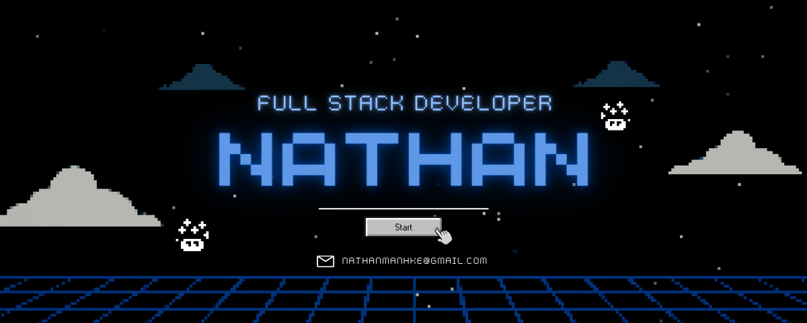

  
 <h1 align="center">Oi, eu sou o Nathan 👋</h1> 
 Desenvolvedor formado em Sistemas para Internet, focado em criar aplicações  que resolvem problemas reais — do banco de dados ao deploy. 
 
     
   
 <i>"Somos o que fazemos repetidamente. A excelência não é um feito, é um hábito." — Aristóteles</i> 

🙋🏼‍♂️ Sobre mim
🎓 Formado em Sistemas para Internet
🔭 Construindo projetos próprios: finanças pessoais, app de treino e plataforma EAD
🌱 Aprendendo agora: TypeScript
📫 Fale comigo: nathanmanhke@gmail.com
🚀 Projetos em destaque
Projeto	Descrição	Stack
Fluxo Pessoal	App de controle financeiro que substituiu minha planilha — login por pessoa, dashboard e dados mensais	Postgres (Neon) · Vercel
Gafit	App web de treino: fichas, registro de cargas e séries, cardio e progresso, pensado para o celular	Em desenvolvimento
Plataforma EAD	Plataforma de cursos online com vídeos hospedados na nuvem	Cloudflare R2 · Em desenvolvimento
💻 Tecnologias

Linguagens e front-end

      

Banco de dados e infraestrutura

     

Ferramentas

     

📊 Estatísticas

   
 
  
   
  

