  
   
     
   <h2>🙋🏼‍♂️ Sobre mim</h2> 
Sou desenvolvedor formado em <b>Sistemas para Internet</b> e gosto de construir aplicações completas, do banco de dados ao deploy. Hoje estou focado em <b>TypeScript</b> e em projetos próprios que resolvem problemas do meu dia a dia.
 <blockquote><i>"Somos o que fazemos repetidamente. A excelência não é um feito, é um hábito." — Aristóteles</i></blockquote> <h2>🚀 Projetos</h2> <table> <tr> <td width="33%" valign="top"> <h3>🗂️ Portal Engemarkc</h3> 
Sistema interno da Engemarkc: clientes, pedidos, estoque, recebimentos, licenciamento de máquinas e controle de acesso por cargo.
 
<code>Laravel</code> <code>PHP</code> <code>MySQL</code>
 <i>Sistema interno</i> </td> <td width="33%" valign="top"> <h3>🏭 Site Engemarkc</h3> 
Site institucional da Engemarkc, empresa de equipamentos de marcação industrial: catálogo de produtos, captação de contatos, SEO e performance.
 
<code>PHP</code> <code>MySQL</code> <code>API própria</code>
 <a href="https://engemarkc.com"><b>Ver online →</b></a> </td> <td width="33%" valign="top"> <h3>🛒 Loja Engemarkc</h3> 
Loja virtual da Engemarkc para venda online dos produtos da empresa.
 
<code>E-commerce</code>
 <a href="https://loja.engemarkc.com"><b>Ver online →</b></a> </td> </tr> <tr> <td width="33%" valign="top"> <h3>💸 Fluxo Pessoal</h3> 
Controle financeiro que substituiu minha planilha: login por pessoa, dashboard e histórico mensal.
 
<code>Postgres</code> <code>Neon</code> <code>Vercel</code>
 </td> <td width="33%" valign="top"> <h3>🏋️ Gafit</h3> 
App de treino feito para o celular: fichas, cargas, séries, cardio e evolução.
 
<code>Web App</code> <code>Mobile first</code>
 <i>Em desenvolvimento</i> </td> <td width="33%" valign="top"> <h3>🎓 Plataforma EAD</h3> 
Plataforma de cursos online com vídeos armazenados na nuvem.
 
<code>Cloudflare R2</code>
 <i>Em desenvolvimento</i> </td> </tr> </table> <h2>💻 Stack</h2> 
  
 <h2>📊 Atividade</h2> 
   
   
  

